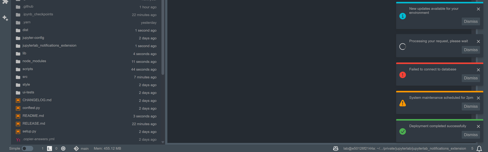
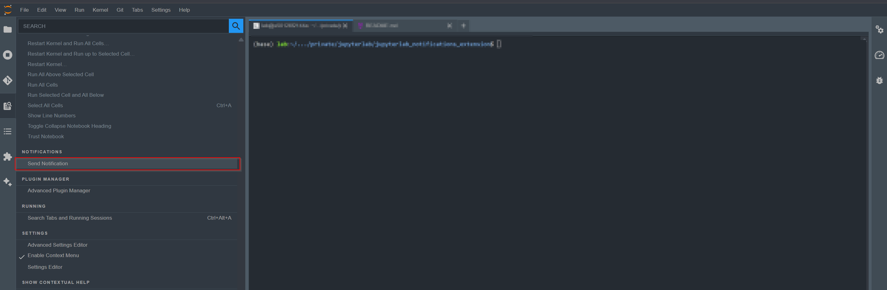

# jupyterlab_notifications_extension

[](https://github.com/stellarshenson/jupyterlab_notifications_extension/actions/workflows/build.yml)
[](https://www.npmjs.com/package/@stellarshenson/jupyterlab-notifications-extension)
[](https://pypi.org/project/jupyterlab-notifications-extension/)
[](https://pepy.tech/project/jupyterlab-notifications-extension)
[](https://jupyterlab.readthedocs.io/en/stable/)
[](https://kolomolo.com)
[](https://www.paypal.com/donate/?hosted_button_id=B4KPBJDLLXTSA)

> [!TIP]
> This extension is part of the [stellars_jupyterlab_extensions](https://github.com/stellarshenson/stellars_jupyterlab_extensions) metapackage. Install all Stellars extensions at once: `pip install stellars_jupyterlab_extensions`

JupyterLab extension that shows notifications from external systems in the native notification system: a toast, the notification center, and optional action buttons. Messages may carry simple Markdown and a small HTML subset.

The extension is the notification backbone for [Stellars JupyterHub Platform for Data Science](https://github.com/stellarshenson/stellars-jupyterhub-ds). A notification is posted to one JupyterLab server and shown to every open tab of that server.



The command palette sends a notification by hand:



## Features

- REST API for external systems, with token authentication
- Command palette dialog and the programmatic `jupyterlab-notifications:send` command
- Six notification types: default, info, success, warning, error, in-progress
- Auto-close in milliseconds, manual dismiss, or silent mode that shows the center only
- Action buttons that run any JupyterLab command
- Markdown and sanitised HTML rendering, including colour and font-size spans
- Dynamic time-ago indicator on every notification
- 30-second polling, with an immediate WebSocket push for `--now`
- `transient` notifications that leave nothing in the notification center

## Agent Skill

`.agents/skills/jupyterlab-notifications-extension/SKILL.md` tells an AI assistant how to drive the `jupyterlab-notify` CLI. It carries the rules `--help` cannot state; the command reference stays in `--help`.

The skill ships in the repository and in the wheel, at `<sys.prefix>/share/jupyter/agents/skills/jupyterlab-notifications-extension/SKILL.md`. One of the two links below makes it readable:

```bash
# After pip install, with the Python that runs the lab
mkdir -p ~/.agents/skills && ln -sfn "$(python -c 'import sys; print(sys.prefix)')/share/jupyter/agents/skills/jupyterlab-notifications-extension" ~/.agents/skills/jupyterlab-notifications-extension

# From a clone, into Claude Code
ln -sfn "$PWD/.agents/skills/jupyterlab-notifications-extension" ~/.claude/skills/jupyterlab-notifications-extension
```

## Installation

```bash
pip install jupyterlab_notifications_extension
```

Requires JupyterLab 4.6.0 or later and Python 3.12 or later.

## API Reference

### POST /jupyterlab-notifications-extension/ingest

Posts one notification. Authentication is an `Authorization: token <TOKEN>` header; do not put the token in the URL, where it lands in server and proxy access logs.

```json
{
  "message": "Your notification message",
  "type": "info",
  "autoClose": 5000,
  "immediate": true,
  "transient": true,
  "actions": [
    {
      "label": "Click here",
      "caption": "Additional info",
      "displayType": "accent"
    }
  ]
}
```

| Field       | Type           | Required | Default  | Description                                                                                                                            |
| ----------- | -------------- | -------- | -------- | -------------------------------------------------------------------------------------------------------------------------------------- |
| `message`   | string         | Yes      | -        | Notification message, rendered as Markdown with limited HTML (see [Message Formatting](#message-formatting))                           |
| `type`      | string         | No       | `"info"` | Visual style: `default`, `info`, `success`, `warning`, `error`, `in-progress`                                                          |
| `autoClose` | number/boolean | No       | `5000`   | Milliseconds before auto-dismiss. `false` = manual dismiss only. `0` = silent mode (notification center only, no toast)                |
| `immediate` | boolean        | No       | `false`  | Push instantly to connected clients via WebSocket instead of waiting for the next poll (see [Immediate Delivery](#immediate-delivery)) |
| `transient` | boolean        | No       | `false`  | Dismiss the notification when its toast closes, so it does not remain in the notification center                                       |
| `data`      | object         | No       | -        | Arbitrary JSON attached to the notification; every number in it must be finite                                                         |
| `actions`   | array          | No       | `[]`     | Action buttons (see below)                                                                                                             |

A transient notification exists only while its toast is visible: its links and action buttons are removed with the toast.

| Field         | Type   | Required | Default     | Description                                                      |
| ------------- | ------ | -------- | ----------- | ---------------------------------------------------------------- |
| `label`       | string | Yes      | -           | Button text                                                      |
| `caption`     | string | No       | `""`        | Tooltip text                                                     |
| `displayType` | string | No       | `"default"` | Visual style: `default`, `accent`, `warn`, `link`                |
| `commandId`   | string | No       | -           | JupyterLab command ID to execute (e.g., `filebrowser:open-path`) |
| `args`        | object | No       | `{}`        | Arguments passed to the command                                  |

Any button click dismisses the notification; a `commandId` runs that command first.

Response `200 OK`:

```json
{
  "success": true,
  "notification_id": "notif_1762549476180_1"
}
```

Errors:

- `400 Bad Request` - invalid JSON, a body that is not a JSON object, a `message` that is missing, empty or not a string, an `actions` that is not a list, an action element that is not an object with a string `label`, or a number anywhere in the payload that is not finite (`NaN`, `Infinity`, or a literal that overflows to one)
- `403 Forbidden` - missing or invalid authentication token
- `500 Internal Server Error` - server-side processing error

## Usage Examples

### From another JupyterLab extension

```javascript
await app.commands.execute('jupyterlab-notifications:send', {
  message: 'Build finished',
  type: 'success',
  autoClose: 3000
});

await app.commands.execute('jupyterlab-notifications:send', {
  message: 'Report ready',
  type: 'info',
  autoClose: false,
  actions: [
    {
      label: 'Open',
      commandId: 'help:open',
      args: { url: 'https://example.com/report' },
      displayType: 'accent'
    }
  ]
});
```

### CLI

`jupyterlab-notify` is installed with the extension:

```bash
jupyterlab-notify -m "Deployment complete" -t success
jupyterlab-notify --url "http://127.0.0.1:8888/jupyterhub/user/alice" -m "Hello"
jupyterlab-notify -m "System maintenance in 1 hour" -t warning --no-auto-close
jupyterlab-notify -m "Task complete" --action "Dismiss"
jupyterlab-notify -m "Help Available!" --action "Open Help" \
  --cmd "iframe:open" --command-args '{"path": "local:///welcome.html"}'
jupyterlab-notify -m "Background task finished" --auto-close 0
jupyterlab-notify -m "Deploy finished" --now
jupyterlab-notify -m "Build finished" --transient
```

URL detection:

- **Listed servers** - `jupyter server list --json`; the URL comes from the record's scheme, host and port, with a loopback address substituted for a wildcard bind
- **Ambiguity** - several servers and none matching `JUPYTERHUB_SERVICE_PREFIX` prints the list and exits 2
- **Fallback** - `JUPYTERHUB_SERVICE_PREFIX`, then `http://127.0.0.1:$JUPYTER_PORT`, port 8888 when unset
- **Explicit `--url`** - a URL matching a listed record is re-addressed to that record's own host, so the host printed can differ from the host given
- **Query and fragment** - dropped, because the endpoint path is appended to the URL
- **No password in `--url`** - the `user:password@` part is dropped from a URL that names a host; two malformed shapes keep it, one with no `//` at all and one whose password holds an unencoded `/`

Authentication:

- **`JUPYTERLAB_NOTIFY_TOKEN`** - this tool's own variable, used for any target; prefer it over `--token`, which puts the secret in argv where every local account can read it
- **Server token** - sent to the address the server's runtime record is reached at: 127.0.0.1 for a server bound to 0.0.0.0, and the bound address for `--ip <address>`
- **Ambient hub variables** - `JUPYTERHUB_API_TOKEN`, `JPY_API_TOKEN` and `JUPYTER_TOKEN` belong to this host, so they are sent only to a loopback target

`--now` pushes over the WebSocket instead of waiting for the next poll.

### cURL

```bash
curl -X POST http://localhost:8888/jupyterlab-notifications-extension/ingest \
  -H "Content-Type: application/json" \
  -H "Authorization: token YOUR_JUPYTER_TOKEN" \
  -d '{"message": "Build completed", "type": "success"}'

curl -X POST http://jupyterhub.example.com/user/alice/jupyterlab-notifications-extension/ingest \
  -H "Content-Type: application/json" \
  -H "Authorization: token YOUR_JUPYTER_TOKEN" \
  -d '{"message": "Deploy finished", "type": "success", "immediate": true}'
```

## Immediate Delivery

By default a notification waits up to 30 seconds for the next poll. `immediate` (REST) or `--now` (CLI) pushes it to every open tab over a WebSocket.

- **Transport** - the frontend keeps a WebSocket open to `/jupyterlab-notifications-extension/stream`
- **Every connected tab** - the push reaches all open tabs at once
- **Best-effort poll** - the queue is a single-consumer destructive drain, so a tab whose socket is down at push time is not guaranteed that notification
- **Keepalive** - ping and pong survive proxy idle timeouts, including behind JupyterHub
- **De-duplication** - notification ids are tracked, so a notification arriving by both push and poll is shown once
- **Reconnect** - capped exponential backoff from 5 to 60 seconds, retrying while the tab stays open

## Time-Ago Indicator

Each notification shows a relative timestamp that updates every 10 seconds: `just now` under a minute, then minutes, hours and days. The indicator sits below the message, or inline with the button bar when actions exist. The notification center shows the same indicator for every listed notification.

## Message Formatting

`message` renders as GitHub-flavoured Markdown and a small HTML subset, sanitised before display, in both the toast and the center. A single newline becomes a line break.

- **Rendered** - paragraphs, bold, italic, strikethrough, inline and fenced code, block quotes, ordered and unordered lists, links and autolinks
- **Tags kept** - `p`, `br`, `strong`, `b`, `em`, `i`, `u`, `s`, `del`, `code`, `pre`, `blockquote`, `ul`, `ol`, `li`, `a`, `span`
- **Attributes kept** - `href`, `title`, `style`, `target`, `rel`
- **Removed** - everything else, including `script`, `style`, `iframe`, `object`, `embed`, `form`, `input`, `img`, `svg`, `math`, `id`, `name`, `class`, `data-*`, `aria-*` and event handlers such as `onclick`
- **Links** - http, https and mailto only; a kept link opens in a new tab with `target="_blank"` and `rel="noopener noreferrer"`, and clicking it does not dismiss the notification
- **Preview** - at most 140 visible characters plus an ellipsis, counted after rendering
- **Other sources** - notifications from JupyterLab or another extension keep plain text and are never parsed

`style` accepts two properties:

| Property    | Accepted values                                                                          |
| ----------- | ---------------------------------------------------------------------------------------- |
| `color`     | 3, 4, 6 or 8 digit hex; a colour keyword; `rgb()`, `rgba()`, `hsl()` or `hsla()`         |
| `font-size` | `0`; 0 to 48 with `px`; 0 to 4 with `em` or `rem`; 0 to 300 with `%`; a CSS size keyword |

Other declarations, including `background`, `position`, `url()`, `expression()`, `var()` and `!important`, are removed.

```bash
jupyterlab-notify -m '**Backup complete** in <span style="color: #2e7d32">12 minutes</span>. Download the [report](https://example.com/report).'
```

## Architecture

A notification is posted to one server; there is no per-recipient addressing. Flow: external POST → in-memory queue → frontend poll every 30 seconds → JupyterLab notification manager → queue cleared after the fetch. Notifications flagged `immediate` are also pushed over the WebSocket and deduplicated against the poll by id.

## Troubleshooting

- **Frontend installed but not working** - `jupyter server extension list` verifies the server extension
- **Server extension enabled but frontend missing** - `jupyter labextension list` verifies the frontend extension
- **Notifications not appearing** - check the browser console for polling errors; restart JupyterLab after installation

## Uninstall

```bash
pip uninstall jupyterlab_notifications_extension
```
